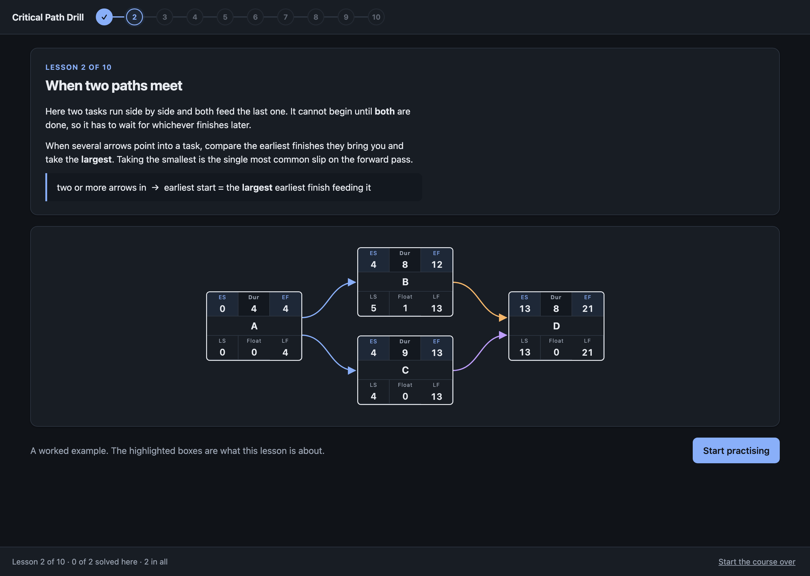
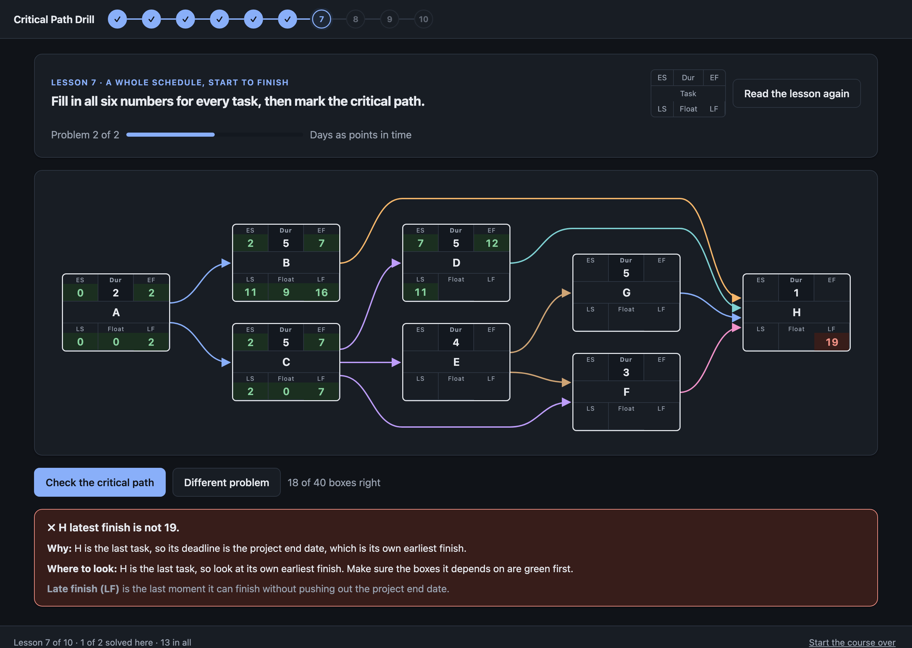

# Critical Path Drill

A short course that teaches you to work out a project schedule by hand, as a desktop app for
Mac and Windows. Ten lessons, each one a page of plain explanation and then practice problems
you answer in the diagram itself. It starts with a single line of three tasks and ends with
exam-sized schedules counted in whole working days.

Every task sits in a box with six blanks: the earliest it can start and finish, the latest it
can start and finish, and how much slack it has. You type your answers in, and each blank is
marked the moment you leave it. A wrong one explains why the number works the way it does and
which boxes to look at, without handing you the answer. Early on the boxes a lesson has not
covered yet stay greyed out, so you are only ever asked for the one idea you just read about.

Your place in the course is saved as you go, so closing the app and coming back picks up where
you left off.





## Install

Download the latest build from
[Releases](https://github.com/bradley-t-t/critical-path-drill/releases).

- **Mac:** open the `.dmg` and drag the app to Applications. It isn't signed by Apple, so the
  first time, right-click the app and choose **Open**, then **Open** again.
- **Windows:** take either `.exe`. The one marked *portable* runs straight from the file with
  nothing to install; the one marked *setup* installs it and puts it in the Start menu. Windows
  SmartScreen will warn about an unknown publisher, so choose **More info** then **Run anyway**.

## What you work through

1. Earliest start and finish, on a straight line of tasks.
2. When two paths meet, and why you take the larger finish.
3. Latest start and finish, working backwards.
4. When one path splits, and why you take the smaller start.
5. Float: how much slack a task has.
6. The critical path: the chain with no slack.
7. A whole schedule, all four steps, start to finish.
8. Bigger schedules, ten tasks and more.
9. Counting whole working days, where every rule gains or loses a day.
10. Exam pace: big schedules in whole working days, three in a row.

Each lesson hands you fresh problems, so you can repeat one as often as you like and never get
the same schedule twice. The number buttons along the top jump back to any lesson you have
finished, and the link at the bottom right starts the course over.

## Run it from source

```
npm install
npm start
```

`app/index.html` is the whole course, with no build step and nothing to load, so opening that
file in a browser works too.

## Build and test

```
npm run verify   # walks the whole course in a real window and checks every answer and hint
npm run dist     # installers for this computer, into dist/
npm run icon     # redraws build/icon.png
```

Pushes to `main` and every pull request build and test on both a Mac and a Windows runner.
Pushing a `v*` tag attaches the installers to a release.

Built with [Electron](https://www.electronjs.org).
