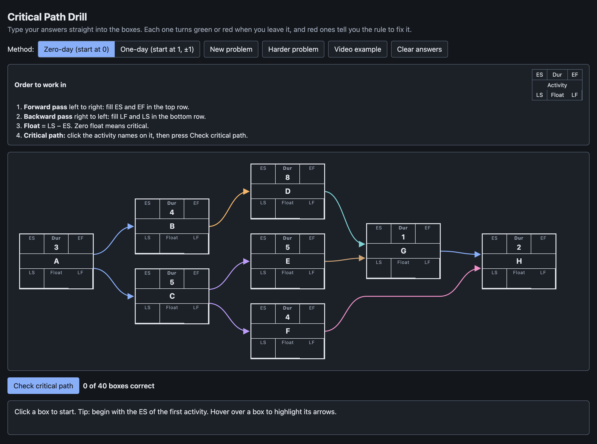

# Critical Path Drill

A practice sheet for working out a project schedule by hand, as a desktop app for Mac and
Windows. Every task sits in a box with six blanks: the earliest it can start and finish, the
latest it can start and finish, and how many days of slack it has. You type your answers in,
and each blank turns green or red the moment you leave it.

A red blank explains itself. It says why the number works the way it does, which boxes to
look at, and gives the textbook definition, without handing you the answer. If your answer is
the one the *other* counting method would give, it says so and shows both rules side by side.



## Install

Download the latest build from
[Releases](https://github.com/bradley-t-t/critical-path-drill/releases).

- **Mac:** open the `.dmg` and drag the app to Applications. It isn't signed by Apple, so the
  first time, right-click the app and choose **Open**, then **Open** again.
- **Windows:** run the `.exe`. The portable one runs straight from the file; the installer
  puts it in the Start menu. Windows SmartScreen will warn about an unknown publisher, so
  choose **More info** then **Run anyway**.

## Use it

1. **Forward pass**, left to right: fill in the earliest start and earliest finish along the top
   of each box.
2. **Backward pass**, right to left: fill in the latest finish and latest start along the bottom.
3. **Float** is the latest start minus the earliest start. No float means the task is critical.
4. Click the names of the tasks you think have no slack, then press **Check critical path**.

**New problem** and **Harder problem** generate a fresh schedule, and **Video example** brings
back the eight-task one. The **Method** switch picks how days are counted: from zero, where a
task that ends at 3 hands off at 3, or from one, where whole working days mean you add and
subtract 1. Hovering a box lights up the arrows in and out of it.

## Run it from source

```
npm install
npm start
```

`app/index.html` is the whole drill, with no build step and nothing to load, so opening that
file in a browser works too.

## Build and test

```
npm run verify   # opens the window, answers 80 generated problems, checks every box
npm run dist     # installers for this computer, into dist/
npm run icon     # redraws build/icon.png
```

Every push builds and tests on both a Mac and a Windows runner. Pushing a `v*` tag attaches
the installers to a release.

Built with [Electron](https://www.electronjs.org).
